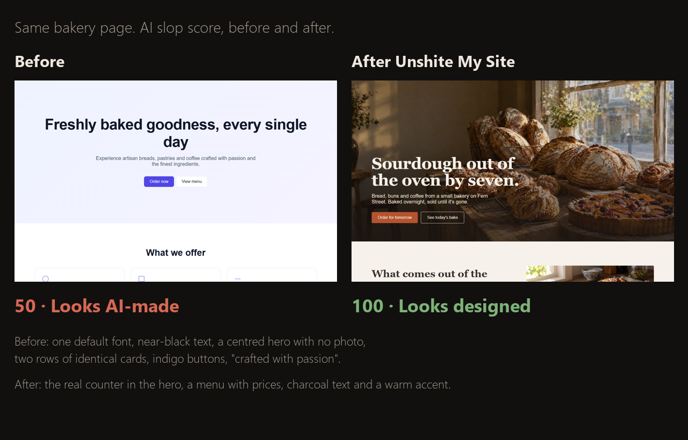

# Unshite My Site

**A free plugin for Claude Code that checks your website for AI slop, gives it a score out of 100, and fixes what it finds.**

Made by a UK web designer as a free taster of No Shite Sites (noshitesites.com).

## Install

1. **Get it free on Gumroad:** [noshitesites.gumroad.com/l/unshite](https://noshitesites.gumroad.com/l/unshite). You'll also get update emails and a short guide to the five AI tells.
2. Drag the zip into a Claude Code chat and type "Install this plugin for me." Claude does the rest (it follows `INSTALL-FOR-CLAUDE.md`).
3. Restart Claude, open your website's project folder and type `/unshite:my-site`. The browser checks need [Node.js](https://nodejs.org).

## What it checks

**The AI look.** The things that make a website read as "made by AI":
- the purple-to-blue gradient, gradient-filled headline words, the default indigo button
- emoji used as icons (🚀 ✨ ⚡)
- one default font (Inter, Roboto, Poppins) for everything
- rows of identical icon + heading + text cards, every section centred, the same layout again and again
- the stock hero: a centred headline, two buttons and no photo, often with a "✨ New" pill on top
- frosted glass and neon glows everywhere
- AI-sounding copy ("elevate your", "seamless", "unlock", "cutting-edge")
- placeholder text, dead links, and made-up round-number stats

**The broken details.** The mistakes AI builders leave behind, on desktop and on a phone:
- images and text cut off at edges, things hidden under a sticky header or bottom bar
- text over photos you can't read (on every slide of a slideshow)
- people cropped out of photos on phones
- sideways scrolling, broken images, links to sections that don't exist
- maps that zoom instead of letting the page scroll
- before/after pictures the wrong way round
- a first screen too heavy to load quickly on a phone

## Good to know
It's made for sites built with Claude Code or Codex. With only a URL (a live site whose code isn't on your computer), it checks and reports but can't fix.

## What happens
1. It scores the site out of 100 and shows you the biggest AI tells and anything broken.
2. It fixes the plain mistakes straight away (cut-offs, contrast, hidden headings, broken links, black text).
3. It lists the design and copy changes it recommends (colours, fonts, layouts, wording) and **asks you once** before making them. It never invents facts about your business: if a line needs real information, it asks.
4. It checks again and gives you the new score, with a full report in `.unshite/report.md`.

**Scores:** 85 to 100 looks designed · 65 to 84 a few AI tells · 40 to 64 looks AI-made · under 40 AI slop.

**Example:** a bakery site set up with the usual AI defaults scored 50 (looks AI-made). With the fixes Unshite My Site recommends (the bakery's own photo in the hero, a menu instead of identical cards, charcoal text, a warm accent and a typeface with character) it scored 100 (looks designed).

## What it runs and what it sends
- **Nothing leaves your computer.** Unshite My Site has no analytics, no account and no server of its own, and sends no data anywhere.
- **A browser on your own site.** Claude opens the site in a browser (the Claude desktop app's built-in browser, Claude in Chrome, or Playwright) and runs the two checking scripts in `skills/my-site/` (`slop-probe.js` and `qa-probe.js`) inside that page. They read the page's layout, text, colours and images. The only network requests they make are to the site being checked: a `HEAD` request for an image that didn't load, to report its status, and a download of the phone-sized hero image, to measure its file size.
- **Your site's own commands.** To check speed, Claude may run your site's `npm run dev`, `npm run build` and `npm run preview`.
- **Playwright, only if needed.** If no browser tool is available, Claude may install Playwright's Chromium (`npx playwright install chromium`). Claude Code asks you before running it.
- **Files it writes.** Fixes go into your site's files (design and wording changes only after you say yes), and the report goes to `.unshite/report.md`. With only a URL, it changes nothing.

## Updates
Update emails come from Gumroad. To update, download the new zip from your Gumroad library and install it the same way.

## Licence
Free to use on your own and your clients' sites, including commercial work. Not open source: please don't resell it or copy it into another product. See `LICENSE.md`.

## Want the whole site designed?
Unshite My Site fixes what's broken and what looks generic. **No Shite Sites** designs the site from a short brief: a concept for the business, art direction, layout, a photography plan and the build, all checked by the same QA before it's done. noshitesites.com

Questions: noshitesites.com
